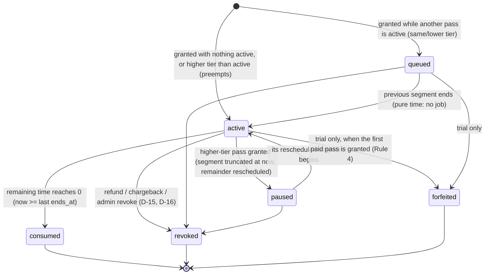

# BringMe! — 7-Day Game Pass Design (Phase 1)

_2026-11-11 · Design only: nothing in the database or application has been changed. Builds on [GAME_PASS_AUDIT.md](GAME_PASS_AUDIT.md) (facts labelled V-code / V-live there)._

Every decision has an ID (**D-n**). Rules 1–12 from the brief are binding. Where they leave something open, the decision is stated here and marked *changeable*, so it can be revisited before Phase 2 without reworking the model.

---

## 1. Concepts and vocabulary

| Term | Meaning |
|---|---|
| **Plan** | A catalogue row (`subscription_plans`): code, tier, player cap, duration, other limits |
| **Price** | One fixed amount for one plan in one currency (`plan_prices`). PHP and USD are separate rows, never converted |
| **Order** | One checkout attempt and its payment outcome (`pass_orders`). This is the **payment** side |
| **Pass** | One granted block of access time for one plan (`game_passes`). This is the **entitlement** side. A paid order creates exactly one pass; trials, admin grants and legacy rows create passes with no order |
| **Segment** | A half-open UTC interval `[starts_at, ends_at)` during which a pass is the active one (`pass_segments`). A pass has 1+ segments: more than one only if it was paused by an upgrade |
| **Entitlement** | What the host may do *at instant t*. It is **derived** from the segment that contains t. Nothing is ever "activated" by a cron job |

**Payment states and entitlement states are separate.** An order can be `paid` while its pass is `queued`, `active`, `consumed` (expired) or `revoked`. An expired pass is a fully consumed pass of a paid order; it is never a failed payment.

---

## 2. State diagrams

### 2.1 Order (payment) lifecycle — stored in `pass_orders.status`

```mermaid
stateDiagram-v2
  [*] --> pending : server creates order + Polar checkout
  pending --> paid : verified webhook order.paid matches order (D-12)
  pending --> failed : verified checkout failed
  pending --> expired : checkout expired / 24 h with no payment (abandoned)
  pending --> canceled : host or admin cancels before payment
  pending --> needs_review : payment evidence does not match (product, currency, amount)
  needs_review --> paid : admin confirms (audited)
  needs_review --> canceled : admin rejects (audited; refund handled in Polar)
  paid --> refunded : verified order.refunded, full amount (D-15)
  paid --> partially_refunded : verified partial refund (no entitlement change)
  partially_refunded --> refunded : remaining amount refunded
  failed --> [*]
  expired --> [*]
  canceled --> [*]
  refunded --> [*]
```



`failed`, `expired`, `canceled` and `needs_review` **grant nothing** (Rule 10). Only the transition into `paid` creates a pass, and it happens exactly once per order (unique `game_passes.order_id`).

### 2.2 Pass (entitlement) lifecycle

Stored: `disposition ∈ {granted, revoked, forfeited}`. Derived from segments and `now()`: `queued | active | paused | consumed`.



### 2.3 Host access state — what `access_state_for()` returns

| State | Condition (evaluated in this order) |
|---|---|
| `deactivated` | `profiles.deactivated_at is not null` |
| `suspended` | `profiles.hosting_suspended_at is not null` (D-17) |
| `active` | a non-revoked, non-forfeited segment contains `now()` |
| `expired` | the host has ever had a pass, and none is active |
| `pending` | never had a pass. The UI shows "Start free trial" if eligible (§5.3), otherwise "Buy a pass" |

These are the **same five labels** the app already uses (`AccessState` in `lib/supabase/database.types.ts`), so existing screens keep working. A `queued`-only state can't occur, because segments are always laid out contiguously from `now()` (§5.2).

---

## 3. Business rules (binding) and decisions

### 3.1 Rules from the brief → how the design satisfies them

| # | Rule | Mechanism |
|---|---|---|
| 1 | Trial starts once, when first validly issued | `start_trial()` creates a trial pass whose segment starts at `now()`. Partial unique index: one trial per user, ever |
| 2 | Trial never restarts via logout/session | Eligibility is read from `game_passes` rows (never deleted), not from session or client state |
| 3 | First paid purchase activates immediately | Replan (§5.2): with no active paid pass, the new pass is first in order and starts at `now()` |
| 4 | Buying a paid pass ends the free trial | Granting any `purchase` pass forfeits the trial: `disposition = forfeited`, segment truncated at `now()`. Unused trial time is **not** kept (it was never paid value) |
| 5 | Same active plan repurchased → +7 days queued | Same tier: FIFO by `seq`, so the new pass is laid out after the current one |
| 6 | Higher tier activates immediately | Ordering is tier desc first, so the new pass moves ahead of the current one |
| 7 | Unused paid access preserved | The pre-empted pass keeps `remaining = duration − consumed`. It gets a new future segment (paused → resumes) |
| 8 | Downgrade after current period | Lower tier sorts after higher tiers, so it's queued |
| 9 | No proration, no automatic refunds | No code path issues refunds or splits prices. Refunds only start in Polar, by a person |
| 10 | Failed/abandoned checkout grants nothing | A pass is only created on the `→ paid` transition |
| 11 | Refunds via explicit, audited policy | §3.3 D-15. Every effect writes an `entitlement_events` row |
| 12 | Existing legitimate access preserved | Backfill converts the live 30-day Starter subscription into a `legacy_subscription` pass with the **same** `[start, end)` (§7.4) |

### 3.2 How unused paid access is calculated (Rules 6 + 7), precisely

For pass *p* at instant *t*:

```
duration(p)  = fixed at grant (seconds; 604 800 for 7 days)
consumed(p,t) = Σ over segments s of p with s.starts_at < t:  least(s.ends_at, t) − s.starts_at
remaining(p,t) = duration(p) − consumed(p,t)          -- always ≥ 0, exact to the microsecond
```

On every grant, revoke or forfeit, the **replan** (§5.2) truncates the segment containing *t* at *t*, deletes future segments, and lays out every pass with `remaining > 0` again, back to back from *t*, in **priority order**:

1. `tier` descending (Pro 3 > Party 2 > Starter 1 > Trial 0)
2. then `seq` ascending (grant order; FIFO within a tier)

This one ordering rule produces Rules 3, 5, 6, 7 and 8 with no special cases. The wall-clock end of each pass moves later when something is placed ahead of it. Its **total** access time never changes.

**Worked example** (all UTC):

| When | Event | Resulting timeline |
|---|---|---|
| Mon 00:00 | buy Starter (S1) | S1 `[Mon 00:00, next Mon 00:00)` |
| Wed 00:00 | buy Pro (P1) | S1 truncated to `[Mon 00:00, Wed 00:00)` (2 d consumed, 5 d remain). P1 `[Wed 00:00, next Wed 00:00)`. S1 resumes `[next Wed 00:00, next Mon+7 d)` = 5 d |
| Thu 00:00 | buy Starter (S2) | P1 continues. S1's 5 d follow, then S2's 7 d after that |
| Fri 12:00 | P1 refunded (revoked) | P1 truncated at Fri 12:00. S1 resumes Fri 12:00 for 5 d, then S2 for 7 d |

**Why segments instead of a "paused balance" field?** Both keep the same value. Segments add three properties a balance field lacks: (a) entitlement at any *t* is a single range lookup, (b) history is never overwritten, so refunds and disputes can be explained, (c) a database exclusion constraint can *prove* no two passes overlap. The equivalent "balance" model (store `remaining_seconds` + one active row) was rejected because its correctness depends on a job or lazy code activating the next row at exactly the right moment.

### 3.3 Decisions (changeable unless marked binding)

| ID | Decision | Rationale |
|---|---|---|
| D-1 | **Tier order**: trial 0, starter 1, party 2, pro 3. Stored as `subscription_plans.tier` (unique among active plans) | Explicit, not derived from price (PHP and USD differ) or player count |
| D-2 | **Duration** = `make_interval(secs => 604800)`, never `interval '7 days'` | `timestamptz + '7 days'` follows the session time zone and can be 167/169 h across DST. Seconds are exact |
| D-3 | **Trial is claimed explicitly** ("Start free trial" button), not auto-granted at signup | Rule 1 says "when first validly issued". Signups who never host don't burn the trial |
| D-4 | **Trial eligibility**: role `subscriber`; not deactivated or suspended; `auth.users.email_confirmed_at` set; **no trial pass ever**; **no `purchase` or `legacy_subscription` pass ever**. Admin grants don't consume eligibility | "Eligible host account". A paying or legacy host doesn't need a trial. Abuse through extra accounts is out of scope and noted (S10 in the audit) |
| D-5 | Trial plan limits: **3 players, 1 open game, 5 rounds, no period cap** (Starter's non-player limits) | The brief only fixes players. The Starter values are the closest audited ones; review in the admin console |
| D-6 | Pro `max_players_per_game` **200 → 100**. Starter 10 and Party 50 unchanged. `max_active_games`, `max_rounds_per_game`, `max_games_per_period` **unchanged** for starter/party/pro | Brief + "preserve existing limits until audited" |
| D-7 | **Snapshot on the pass**: `plan_id`, `tier`, `max_players`, `duration`. Other limits (open games, rounds, period cap) are read live from the plan | A sold pass must not change if an admin edits the plan's player cap later. The other limits are platform policy, already live-read today |
| D-8 | **Room capacity is dynamic until the game starts**. Join check = owner's *current* entitlement `max_players` (fallback `games.max_players` when the owner has none). `games.max_players` is set to the pass cap at creation and raised by `start_game` | Fixes audit M6 (Party/Pro silently capped at 20). An upgrade during a lobby raises its capacity immediately |
| D-9 | **Starting a room** (`start_game`) requires an active entitlement **and** `active players ≤ current max_players`. Otherwise `subscription_required` / `player_limit_exceeded` (the host can remove players or upgrade) | Covers downgrade-by-expiry while a big lobby is open |
| D-10 | **A game that went live while entitled may finish all its pre-created rounds**. The per-round entitlement check in `start_countdown` (migration 11:380-386) is removed. Rounds can't be added after start (existing trigger), so this is bounded | Fixes audit M7: a pass ending at 21:00 shouldn't freeze a party at round 4 of 10. *Changeable*: if rejected, keep the current behaviour |
| D-11 | **Creating a game** needs an active entitlement + the existing limits (open-at-once, period cap, rounds). The period cap counts games since the **current pass's first segment start** | Keeps the migration 6 semantics ("since activation"). All live plans have a null period cap, so nothing changes today |
| D-12 | **Trusted payment evidence** = a webhook whose Standard-Webhooks signature verified on the raw body, **and** whose order metadata `bringme_order_id` matches a `pending` order, **and** whose Polar product id equals that order's `plan_prices.polar_product_id`, **and** whose currency equals the order's currency, **and** whose paid amount ≥ the order's `amount_minor`. Any mismatch → `needs_review`, no pass. Success-page redirects and client claims are **never** evidence | Rule 10. Discounts aren't configured; a lower amount means something is wrong |
| D-13 | **Currency choice**: the host picks PHP or USD on the purchase page (default from `Accept-Language`/locale: `fil`/`en-PH` → PHP, else USD). The server accepts only `PHP`/`USD` and reads the amount from `plan_prices` | Prices are separately configured, not converted. No IP geolocation dependency |
| D-14 | **Polar product mapping**: one Polar product **per plan × currency** (8 products), stored in `plan_prices.polar_product_id`. If Polar supports multiple fixed currency prices on one product, the same columns hold the same product id plus a `polar_price_id` | Works whichever way the audit blocker B1 resolves. No schema change needed later |
| D-15 | **Refund policy** (binding as policy, automatic as mechanism): verified **full** refund → order `refunded`, pass **revoked** at that instant (remaining time removed, already-used time kept as history). **Partial** refund → order `partially_refunded`, pass unchanged, admin flag. **Dispute/chargeback** → pass revoked + admin flag. Refunds are only ever *initiated* by a person in Polar | Rules 9 and 11. Revoking unused time matches returning the money |
| D-16 | **Admin manual grant** = a `admin_grant` pass for any active plan, duration **1–366 whole days (default 7)**, with a required reason. It goes through the same replan (it can pre-empt or queue). Admin **revoke** of any pass needs a reason. Both are audited | Preserves today's admin capability (`activate`, 1–366 days) |
| D-17 | **Suspension** becomes account-level: `profiles.hosting_suspended_at`. While suspended, access state is `suspended` and nothing is allowed; **pass time keeps running** (it isn't paused). Unsuspend clears it | Simple and reversible. Admins can compensate with a grant. Today suspension is stored on the subscription row, which no longer fits |
| D-18 | **Legacy `subscriptions` table is frozen** after cutover: kept as read-only history, never written by app code. Admin history shows both | Additive, no rename (audit §9) |
| D-19 | **Plan identifiers**: keep `code` (`trial`, `starter`, `party`, `pro`) as the stable external key. UUIDs stay internal. Polar metadata carries `bringme_order_id` only, never plan codes or prices | Client and Polar input can't select a price |
| D-20 | **Money storage**: integer **minor units** + ISO-4217 uppercase currency (`PHP` 9900, 19900, 29900; `USD` 199, 349, 499). Legacy `price_cents`/`currency`/`price` columns are left unused (deprecated comment) | Exact and comparable with Polar amounts |
| D-21 | **Abandoned checkout**: a `pending` order older than 24 h is treated as `expired` by every reader. It is marked `expired` by the `checkout.updated` webhook, or lazily the next time that host starts a checkout | No cron needed. Grants nothing either way |
| D-22 | **Concurrent pending checkouts** are allowed (max 3 pending per host, to limit spam). Each paid order becomes its own pass and is laid out by the replan | No "lost" payment if a host opens two tabs |

---

## 4. Database design (additive)

### 4.1 Changes to existing tables

```sql
-- subscription_plans (catalogue) — additive columns
tier              smallint      -- D-1; unique among active plans (partial unique index)
duration_seconds  integer not null default 604800 check (duration_seconds between 3600 and 31622400)
is_trial          boolean not null default false
sort_order        smallint not null default 0
-- CHECK: is_trial = (tier = 0)
-- existing max_players_per_game / max_active_games / max_rounds_per_game / max_games_per_period kept as-is

-- profiles
hosting_suspended_at timestamptz   -- D-17

-- subscriptions: unchanged (frozen, D-18). Comment marks it as legacy history.
```

### 4.2 New types

```sql
create type public.pass_source      as enum ('trial', 'purchase', 'admin_grant', 'legacy_subscription');
create type public.pass_disposition as enum ('granted', 'revoked', 'forfeited');
create type public.order_status     as enum ('pending', 'paid', 'failed', 'expired', 'canceled',
                                             'needs_review', 'refunded', 'partially_refunded');
```

### 4.3 New tables

```sql
create extension if not exists btree_gist;   -- Supabase: available; PGlite: contrib/btree_gist (harness must load it)

create table public.plan_prices (
  id               uuid primary key default gen_random_uuid(),
  plan_id          uuid not null references public.subscription_plans(id),
  currency         char(3) not null check (currency in ('PHP', 'USD')),
  amount_minor     integer not null check (amount_minor > 0),
  polar_product_id text,          -- D-14; null = not purchasable yet
  polar_price_id   text,
  is_active        boolean not null default true,
  created_at       timestamptz not null default now(),
  updated_at       timestamptz not null default now()
);
create unique index plan_prices_one_active on public.plan_prices (plan_id, currency) where is_active;
create unique index plan_prices_polar_product on public.plan_prices (polar_product_id, coalesce(polar_price_id, ''))
  where polar_product_id is not null;
-- Trial has no price row. Price changes = deactivate old row + insert new (orders reference the row they used).

create table public.pass_orders (
  id                  uuid primary key default gen_random_uuid(),
  user_id             uuid not null references public.profiles(id) on delete restrict,
  plan_id             uuid not null references public.subscription_plans(id),
  plan_price_id       uuid not null references public.plan_prices(id),
  currency            char(3) not null,               -- snapshot
  amount_minor        integer not null check (amount_minor > 0),   -- snapshot (expected)
  status              public.order_status not null default 'pending',
  polar_checkout_id   text unique,
  polar_order_id      text unique,
  polar_customer_id   text,
  paid_amount_minor   integer,                        -- evidence
  paid_currency       char(3),                        -- evidence
  refunded_amount_minor integer not null default 0,
  review_reason       text,
  created_at          timestamptz not null default now(),
  paid_at             timestamptz,
  closed_at           timestamptz,                    -- failed/expired/canceled/refunded
  updated_at          timestamptz not null default now(),
  check ((status = 'paid') <= (paid_at is not null and polar_order_id is not null))
);
create index pass_orders_user on public.pass_orders (user_id, created_at desc);

create table public.game_passes (
  id                uuid primary key default gen_random_uuid(),
  seq               bigint generated always as identity unique,  -- FIFO within tier
  user_id           uuid not null references public.profiles(id) on delete restrict,
  plan_id           uuid not null references public.subscription_plans(id),
  source            public.pass_source not null,
  order_id          uuid unique references public.pass_orders(id),          -- one pass per paid order
  legacy_subscription_id uuid unique references public.subscriptions(id),  -- idempotent backfill
  tier              smallint not null,          -- snapshot (D-7)
  max_players       integer not null check (max_players between 2 and 500),  -- snapshot
  duration_seconds  integer not null check (duration_seconds > 0),          -- snapshot
  disposition       public.pass_disposition not null default 'granted',
  ended_at          timestamptz,                -- when revoked/forfeited
  end_reason        text,
  granted_by        uuid references public.profiles(id),   -- admin for admin_grant
  grant_reason      text,
  created_at        timestamptz not null default now(),
  check ((source = 'purchase')            = (order_id is not null)),
  check ((source = 'legacy_subscription') = (legacy_subscription_id is not null)),
  check ((source = 'admin_grant')         <= (granted_by is not null and grant_reason is not null)),
  check ((disposition = 'granted')        = (ended_at is null)),
  check ((disposition = 'forfeited')      <= (source = 'trial'))
);
create unique index game_passes_one_trial_per_user on public.game_passes (user_id) where source = 'trial';
create index game_passes_user on public.game_passes (user_id, tier desc, seq);

create table public.pass_segments (
  id         bigint generated always as identity primary key,
  pass_id    uuid not null references public.game_passes(id) on delete restrict,
  user_id    uuid not null,                       -- denormalised for the exclusion constraint
  starts_at  timestamptz not null,
  ends_at    timestamptz not null,
  check (ends_at > starts_at),
  -- THE invariant: a host never has two passes active at the same instant (half-open intervals).
  exclude using gist (user_id with =, tstzrange(starts_at, ends_at, '[)') with &&)
);
create index pass_segments_lookup on public.pass_segments (user_id, starts_at, ends_at);
-- Trigger: user_id must equal the pass's user_id; segments that started before now() are immutable
-- except lowering ends_at to exactly now() (truncation); delete only if starts_at >= now().

create table public.payment_events (                 -- raw webhook inbox (idempotency)
  id            bigint generated always as identity primary key,
  provider      text not null default 'polar',
  event_id      text not null,                       -- webhook-id header
  event_type    text not null,
  received_at   timestamptz not null default now(),
  processed_at  timestamptz,
  outcome       text,                                -- applied | duplicate | ignored | needs_review | error
  order_id      uuid references public.pass_orders(id),
  payload       jsonb not null,                      -- verified body (no secrets/card data)
  unique (provider, event_id)
);

create table public.entitlement_events (             -- append-only audit
  id          bigint generated always as identity primary key,
  at          timestamptz not null default now(),
  user_id     uuid not null,
  pass_id     uuid,
  order_id    uuid,
  actor_kind  text not null check (actor_kind in ('system', 'webhook', 'admin', 'host', 'migration')),
  actor_id    uuid,
  action      text not null,  -- trial_started | pass_granted | pass_preempted | pass_resumed | trial_forfeited
                              -- | pass_revoked | order_created | order_paid | order_failed | order_expired
                              -- | order_needs_review | order_refunded | order_partially_refunded
                              -- | admin_suspend | admin_unsuspend | legacy_backfill
  details     jsonb not null default '{}'
);
-- Trigger: rejects UPDATE/DELETE for every role (append-only).
```

### 4.4 Constraint summary (what the database itself guarantees)

| Invariant | Enforced by |
|---|---|
| No two passes active at once per host | `pass_segments` GiST exclusion on `(user_id, [starts_at, ends_at))` |
| One trial per account, ever | partial unique `game_passes_one_trial_per_user`; rows never deleted (no DELETE grant, FK `on delete restrict`) |
| One pass per paid order | `game_passes.order_id unique` |
| One order per Polar order / checkout | `polar_order_id unique`, `polar_checkout_id unique` |
| Webhook processed once | `payment_events unique (provider, event_id)` |
| Legacy backfill runs once | `game_passes.legacy_subscription_id unique` |
| One active price per plan × currency | partial unique `plan_prices_one_active` |
| Paid orders carry evidence | CHECK on `pass_orders` |
| History not rewritten | segment trigger (past is immutable), append-only audit trigger |

### 4.5 RLS and grants

| Table | `anon` | `authenticated` (host) | super admin (via `is_super_admin()`) | `service_role` |
|---|---|---|---|---|
| plan_prices | select active rows (pricing page), columns without Polar ids | same | select all | all |
| pass_orders | — | select **own** rows (no `polar_*` columns, no `review_reason`) | select all | all (writes only via functions) |
| game_passes / pass_segments | — | select own | select all | all (writes only via functions) |
| payment_events | — | — | — (via admin RPC only) | all |
| entitlement_events | — | — | select | insert only |
| subscription_plans | unchanged (active rows) | unchanged | unchanged | unchanged |

There are **no client INSERT/UPDATE/DELETE** grants on any new table. Every write goes through `SECURITY DEFINER` functions that are service-role only, except `start_trial()` (authenticated, checks `auth.uid()`). New tables start with `revoke all … from public, anon, authenticated` (Supabase grants everything by default, as in audit §2).

### 4.6 Functions (signatures; bodies in Phase 2)

| Function | Caller | Purpose |
|---|---|---|
| `replan_passes(p_user uuid)` *internal* | other functions only | §5.2. Requires the caller to hold the profile lock |
| `grant_pass(p_user, p_plan_code, p_source, p_duration_seconds, p_order uuid, p_actor uuid, p_reason text) → uuid` | service_role | Creates the pass, forfeits the trial if `purchase`, replans, audits |
| `start_trial() → jsonb` | authenticated | Eligibility (D-4), then `grant_pass(auth.uid(),'trial','trial',…)`. Unique violation → `trial_already_used` |
| `create_pass_order(p_user, p_plan_code, p_currency) → (order_id, amount_minor, polar_product_id)` | service_role | Validates plan, active price, ≤3 pending, user state |
| `attach_checkout(p_order, p_polar_checkout_id)` | service_role | Stores the checkout id |
| `apply_payment_event(p_event_id, p_type, p_payload jsonb) → text` | service_role | Inbox insert (dedupe) + dispatch to the order transitions below, all in one transaction |
| `apply_order_paid / _failed / _expired / _refunded(...)` *internal* | via `apply_payment_event` | Order transition + pass effects |
| `admin_grant_pass(p_user, p_plan_code, p_days, p_reason)` / `admin_revoke_pass(p_pass, p_reason)` / `admin_set_suspended(p_user, bool, p_reason)` | service_role (handler checks `requireSuperAdmin`) | D-16, D-17 |
| `pass_timeline(p_user) → table` / `my_game_pass() → jsonb` | admin / authenticated (own) | UI: current pass, queue, remaining, history |
| `entitlement_for(p_user)` | existing (same signature) | **Rewritten** to read segments (§5.1). Column `subscription_id` now holds the pass id |
| `access_state_for`, `my_access_status`, `my_entitlement` | existing | Same signatures, new source |
| `admin_set_subscription(...)` | existing | Compatibility shim: `activate` → `admin_grant_pass`; `suspend` → `admin_set_suspended`; `set_plan`/`set_expiry` → `unsupported_for_game_pass` (UI updated in the same phase) |

---

## 5. Entitlement resolution algorithm

### 5.1 `entitlement_for(user, t = now())`

```
1. profile := profiles[user];  if missing or deactivated_at → NONE('deactivated')
2. if profile.hosting_suspended_at is not null           → NONE('suspended')
3. seg := pass_segments s join game_passes p on p.id = s.pass_id
          where s.user_id = user and s.starts_at <= t and t < s.ends_at
            and p.disposition = 'granted'                    -- revoked/forfeited were truncated anyway
          (≤ 1 row guaranteed by the exclusion constraint)
4. if seg is null → NONE(ever_had_pass ? 'expired' : 'pending')
5. return ACTIVE {
     pass_id              = p.id                (exposed as subscription_id for compatibility)
     plan_code            = plans[p.plan_id].code
     source               = p.source
     max_players_per_game = p.max_players       (snapshot, D-7)
     max_active_games, max_rounds_per_game, max_games_per_period = plans[p.plan_id] (live)
     activated_at         = min(starts_at) over p's segments     (period start for D-11)
     current_period_end   = seg.ends_at          (when THIS pass stops being the active one)
     access_until         = end of the contiguous chain of segments starting at seg.ends_at
     payment_status       = orders[p.order_id].status, or null for trial/admin/legacy
   }
```

It is pure time: the same query gives the right answer at any instant, with no job and no write on read.

**Derived answers**

| Question | Answer |
|---|---|
| Host identity | `auth.uid()` (session) → `profiles.id`; role from `profiles.role` |
| Active plan / max players / activation / expiration / source | §5.1 fields |
| Payment verification status | `payment_status` (`paid` for a purchase pass; `refunded` can't be active because it gets revoked) |
| Trial eligibility | §5.3 |
| Pass history | `pass_timeline(user)`: every pass with derived state + segments + order status |
| Can create a game? | ACTIVE and open games < `max_active_games` and period count < `max_games_per_period` (null = ∞). Error codes unchanged: `subscription_required`, `game_limit_reached`, `period_game_limit_reached` |
| Can start an existing room? | ACTIVE and active players ≤ `max_players_per_game` (D-9) → else `subscription_required` / `player_limit_exceeded` |
| Can a player join? | lobby, and players < (owner ACTIVE ? `max_players_per_game` : `games.max_players`) (D-8) |
| Can the next round start? | game is `live` (D-10: no entitlement re-check) |

### 5.2 `replan_passes(user)` — runs inside the caller's transaction

```
precondition: caller holds  SELECT … FROM profiles WHERE id = user FOR UPDATE
t := now()                                   -- one instant for the whole replan
1. UPDATE pass_segments SET ends_at = t  WHERE user_id = user AND starts_at < t AND ends_at > t
2. DELETE FROM pass_segments             WHERE user_id = user AND starts_at >= t
3. candidates := passes of user with disposition = 'granted' and remaining(p, t) > 0
                 ORDER BY tier DESC, seq ASC
4. cursor := t
   for p in candidates:
       if p has a segment ending exactly at cursor (the one truncated in step 1, continuing):
            extend it: ends_at = cursor + remaining(p,t)  (no fragmenting when nothing changed)
       else insert segment [cursor, cursor + remaining(p,t))
       cursor := cursor + remaining(p,t)
       audit pass_preempted / pass_resumed when a pass's position changed
```

Steps 1–2 never touch time that has already passed (enforced by the segment trigger), so consumed time is final. The exclusion constraint checks the result before commit, which catches any bug in this algorithm.

### 5.3 Trial eligibility `trial_eligibility(user) → (eligible bool, reason text)`

Ineligible reasons, checked in order: `not_subscriber`, `deactivated`, `suspended`, `email_unconfirmed`, `trial_already_used`, `has_paid_history` (any `purchase` or `legacy_subscription` pass). Otherwise eligible. Final race protection: the partial unique index.

---

## 6. Security design

### 6.1 Server authorization

| Endpoint (Phase 3+) | Checks, in order |
|---|---|
| `POST /api/billing/checkout` `{planCode, currency}` | `requireRole('subscriber')` → not deactivated/suspended → validate `planCode ∈ active non-trial plans`, `currency ∈ {PHP,USD}` → `create_pass_order` (service role) → Polar checkout created **server-side** with the product id from the DB, `metadata.bringme_order_id`, `external_customer_id = user id`, success URL from `NEXT_PUBLIC_SITE_URL` → `attach_checkout` → return Polar URL (redirect; no embed, see audit S9) |
| `POST /api/billing/trial` | `requireRole('subscriber')` → `rpc('start_trial')` under the user's session |
| `POST /api/webhooks/polar` | **No session.** Proxy allow-list entry. Raw body ≤ 64 KB → verify signature with `POLAR_WEBHOOK_SECRET` (server-only env) and reject timestamps > 5 min old → `apply_payment_event` via service role → 2xx on `applied/duplicate/ignored/needs_review`; 5xx only on transient DB errors (Polar retries) |
| `GET /dashboard/billing/success` | Shows "Processing…" and polls `my_game_pass()`. **Never** grants anything |
| Admin grant/revoke/suspend | `requireSuperAdmin()` → `lib/admin/validation` → service-role RPC (existing pattern) |

Secrets: `POLAR_ACCESS_TOKEN`, `POLAR_WEBHOOK_SECRET` are server-only, never `NEXT_PUBLIC_*`, never logged. Polar SDK (if used) is pinned to an exact version (audit S6). The Polar server (sandbox/production) is chosen by env.

### 6.2 Webhook idempotency and ordering

1. `INSERT INTO payment_events … ON CONFLICT (provider, event_id) DO NOTHING RETURNING id`. If no row comes back, the event is a duplicate → return 200 (`duplicate`). A concurrent duplicate blocks on the unique index until the first commits, then sees the conflict.
2. In the **same transaction**: lock the order (`FOR UPDATE`) found by `metadata.bringme_order_id` (fallback `polar_checkout_id`/`polar_order_id`), then lock the profile, then transition.
3. Transitions are **monotonic**: an out-of-order `checkout.expired` arriving after `order.paid` is recorded and `ignored`. A `paid` event for an order already `paid` with the same `polar_order_id` is `duplicate`. A different `polar_order_id` → `needs_review`.
4. Unknown event types → stored with `ignored`.
5. Event names to bind in Phase 2 (verify against the pinned Polar docs/SDK): `order.paid` (grant), `order.refunded` (D-15), `checkout.updated` (failed/expired), dispute events if Polar emits them.

### 6.3 Transactions and concurrency

- **Lock order (always the same, to avoid deadlocks):** order row → profile row → (segments). Functions that have no order start at the profile.
- **Isolation:** default READ COMMITTED is sufficient, because every entitlement write for a host is serialised by the profile row lock and verified by the exclusion constraint. Readers (triggers, `entitlement_for`) see committed segments only.
- **Concurrent purchases** (two tabs, two currencies): two orders, two webhooks. Each takes the profile lock in turn, so the second replan sees the first pass → queued or pre-empting, as the ordering rule says. No double grant (unique `order_id`), no overlap (exclusion).
- **Purchase racing `start_trial`**: both lock the profile. If the trial commits first, the purchase forfeits it. If the purchase commits first, the trial fails with `has_paid_history`.
- **Entitlement read racing a replan** (e.g. `start_game` while a refund lands): `start_game` reads entitlement after locking the game row. Worst case it uses the state from one transaction earlier. Acceptable: both states were legitimate at their instant.
- **Game creation vs. pass expiry**: the trigger evaluates `now()` (transaction start). A pass ending mid-transaction still counts for that transaction. This is accepted and documented.

### 6.4 Security invariants (each becomes at least one test)

- **I-1** No client role can insert/update/delete passes, segments, orders, prices, payment or audit events.
- **I-2** A pass with `source = purchase` exists only for an order that reached `paid` through verified evidence (D-12) or an audited admin review.
- **I-3** At any instant a host has ≤ 1 active segment.
- **I-4** A host has ≤ 1 trial pass, ever. Deleting a profile is blocked while passes exist (`on delete restrict`). Account deletion is an admin process that keeps the ledger.
- **I-5** Consumed time is never changed. Only future time is rescheduled.
- **I-6** Sum of segment lengths of a pass ≤ its `duration_seconds` (equal unless revoked/forfeited/still running).
- **I-7** Price, currency and plan used for payment come only from `plan_prices` on the server. Client input can only *select* `(planCode, currency)`.
- **I-8** Each webhook event changes state at most once. Out-of-order events never move an order backwards.
- **I-9** Every entitlement-changing action writes exactly one `entitlement_events` row in the same transaction. Audit rows are immutable.
- **I-10** Expired ≠ failed: `access_state = expired` never implies an order status other than `paid`/`refunded`, and failed orders never appear as passes.
- **I-11** Existing legacy access is unchanged by the migration: same plan, same `[start, end)`.

---

## 7. Migration plan (Phase 2 implements; nothing is applied now)

### 7.0 Preconditions (from the audit; blocking)
1. Run the audit's §10 read-only queries. Confirm migration 12, `games.max_players` default, `subscriptions` indexes/triggers, `rls_auto_enable`.
2. Repair `schema_migrations` if empty (audit R1).
3. Resolve Polar blocker B1 (only affects which `plan_prices` columns get filled, not the schema).
4. Backup (Dashboard → Backups or `pg_dump`).

### 7.1 Order of files (each its own transaction, all re-runnable)

| # | File (proposed) | Content | Behaviour change? |
|---|---|---|---|
| 1 | `20261112000001_game_pass_types.sql` | 3 enums (guarded `duplicate_object`) | none |
| 2 | `20261112000002_plan_catalogue.sql` | plan columns `tier/duration_seconds/is_trial/sort_order`; upsert **trial** (`on conflict (code)`); set tiers; **Pro max_players 200→100**; `plan_prices` table + 6 rows; deprecate legacy price columns (comment only) | Pro cap lower (no live Pro hosts, audit §2) |
| 3 | `20261112000003_pass_ledger.sql` | `btree_gist`; `game_passes`, `pass_segments` (+ exclusion, triggers), `entitlement_events` (+ append-only trigger), `profiles.hosting_suspended_at`; grants/RLS | none (empty tables) |
| 4 | `20261112000004_orders_webhooks.sql` | `pass_orders`, `payment_events`; grants/RLS | none |
| 5 | `20261112000005_pass_functions.sql` | `replan_passes`, `grant_pass`, `start_trial`, `trial_eligibility`, order/payment functions, admin functions, `pass_timeline`, `my_game_pass` | none (nothing calls them yet) |
| 6 | `20261112000006_legacy_backfill.sql` | §7.4 | none (passes mirror subscriptions) |
| 7 | `20261112000007_entitlement_cutover.sql` | Rewrite `entitlement_for`, `access_state_for` (same signatures); `enforce_game_insert` (D-8 cap, D-11 period); `enforce_player_insert` (D-8); `game_transition` (D-9 start check, D-10 remove per-round check); `admin_set_subscription` shim; comment `subscriptions` as frozen | **Yes**: the cutover |

Files 1–6 can be applied and verified with **zero behaviour change**. File 7 is the only switch, which keeps the rollback surface to one file.

Test harness changes in the same phase: load `btree_gist` in `tests/db/harness.ts` (PGlite contrib). The subscription helper (`harness.ts:66`, direct `subscriptions` insert) switches to `grant_pass`. Legacy-compat fixture gains the extra live legacy columns (audit §3).

### 7.2 Plan data (file 2)

| code | tier | name | players | open games | rounds | period cap | duration | PHP | USD |
|---|---|---|---|---|---|---|---|---|---|
| trial | 0 | Free Trial | 3 | 1 | 5 | null | 604800 s | — | — |
| starter | 1 | Starter | 10 | 1 *(kept)* | 5 *(kept)* | null *(kept)* | 604800 s | 9900 | 199 |
| party | 2 | Party | 50 | 3 *(kept)* | 15 *(kept)* | null *(kept)* | 604800 s | 19900 | 349 |
| pro | 3 | Pro | **100** (was 200) | 10 *(kept)* | 40 *(kept)* | null *(kept)* | 604800 s | 29900 | 499 |

Upserts update only `tier/duration_seconds/is_trial/sort_order` and Pro's cap. They never overwrite admin-edited limits (`max_active_games` etc.) on existing rows. `polar_product_id` is left null until products exist: a price with no product id isn't purchasable (checkout refuses `plan_not_purchasable`).

### 7.3 Validation queries (run after each file; all read-only)

```sql
-- after 2: catalogue
select code, tier, is_trial, duration_seconds, max_players_per_game, max_active_games, max_rounds_per_game, max_games_per_period
from public.subscription_plans order by tier;
select p.code, pp.currency, pp.amount_minor, pp.polar_product_id is not null as purchasable
from public.plan_prices pp join public.subscription_plans p on p.id = pp.plan_id where pp.is_active order by 1, 2;
-- expect exactly 6 rows; trial has none

-- after 3/4: privileges (all must be false)
select t, has_table_privilege('authenticated', t, 'INSERT') or has_table_privilege('authenticated', t, 'UPDATE')
       or has_table_privilege('authenticated', t, 'DELETE') as client_can_write
from unnest(array['public.game_passes','public.pass_segments','public.pass_orders',
                  'public.payment_events','public.entitlement_events','public.plan_prices']) t;

-- after 6: every entitling subscription mirrored exactly (expect 0 rows)
select s.id from public.subscriptions s
left join public.game_passes gp on gp.legacy_subscription_id = s.id
left join public.pass_segments ps on ps.pass_id = gp.id
where s.status in ('trialing','active') and s.current_period_end > now()
  and (ps.id is null or ps.starts_at <> s.current_period_start or ps.ends_at <> s.current_period_end);

-- before 7 (dry comparison; expect 0 rows): new resolution == old resolution for every user
-- (Phase 2 provides public._entitlement_v2(uuid) alongside the old function for this check)

-- after 7: no overlaps (expect 0; the constraint makes this a sanity check)
select a.user_id from public.pass_segments a join public.pass_segments b
  on a.user_id = b.user_id and a.id < b.id
 and tstzrange(a.starts_at, a.ends_at, '[)') && tstzrange(b.starts_at, b.ends_at, '[)');
-- live subscriber still active with the same end
select state, plan_code, current_period_end from public.access_state_for('<subscriber uuid>');
```

### 7.4 Legacy subscription rows (file 6)

For every `subscriptions` row (live: **1**, status `active`, `starter`, `[2026-11-11 08:26:51 UTC, 2026-12-11 08:26:51 UTC)`):

| Legacy row | Becomes |
|---|---|
| status `trialing`/`active`, period overlaps `now()` or is in the future | pass `legacy_subscription`, plan = same, `tier`/`max_players` = **plan values at backfill time** (starter → 10), `duration_seconds = end − start`, one segment `[current_period_start, current_period_end)` exactly |
| status `suspended` with a future end | same pass, **plus** `profiles.hosting_suspended_at = now()` (preserves the suspension, D-17) |
| ended / `canceled` / `expired` / `past_due` | pass `legacy_subscription` with `disposition = granted` and its historical segment (all in the past → `consumed`). Keeps history and makes `expired` state and trial ineligibility (D-4) correct |
| overlapping legacy rows for one user (not expected; prevented by the one-live index) | backfill stops with `legacy_overlap` and names the rows, changing nothing (as the compat migration does) |

The backfill inserts segments directly (not via replan) because it reproduces history exactly. The exclusion constraint validates it. One `entitlement_events` row (`legacy_backfill`, actor `migration`) per pass. Re-run safety: `legacy_subscription_id unique` + `on conflict do nothing`.

**Manual grants are preserved:** today's manual grants *are* the subscriptions rows above, so they become `legacy_subscription` passes with identical intervals. After cutover, new manual grants are `admin_grant` passes (D-16).

### 7.5 Forward strategy
- Files 1–6 deploy **before** any app change. The app keeps working on the old functions.
- File 7 and the app release (UI copy, billing routes, admin screens) ship **together**. The function signatures don't change, so the current app also works against file 7. Only `set_plan`/`set_expiry` return `unsupported_for_game_pass`.
- Polar goes live afterwards: fill `polar_product_id`, set the env secrets, register the webhook URL. Until then the trial and admin grants work, and checkout reports `plan_not_purchasable`.

---

## 8. Rollback / compensating strategy

| Scope | How | Data loss |
|---|---|---|
| Files 1–6 | Nothing to roll back functionally (no behaviour change). Optionally leave the tables in place | none |
| File 7 (cutover) | **Compensating migration** `…_entitlement_cutover_revert.sql`: (a) re-create the previous bodies of `entitlement_for`, `access_state_for`, `enforce_game_insert`, `enforce_player_insert`, `game_transition`, `admin_set_subscription` (copied verbatim from migrations 6/9/11 into the revert file *at Phase 2 time*); (b) **project passes back**: for each host with an active segment, upsert one `subscriptions` row (`status active`, `plan_id`, `[now(), access_until)`), so post-cutover buyers keep access under the old model (the one-live-per-user index fits, because projection is one row per user); (c) `hosting_suspended_at` → `status suspended` on that row | Queue *ordering* detail collapses to "access until X on the current plan" during the rollback; ledger tables keep the full truth for re-cutover |
| Bad plan data (file 2) | Forward-fix migration (upsert values). Never delete plans that orders reference | none |
| Destructive cleanup (drop legacy columns, drop `subscriptions`) | **Not in scope.** A separate, explicitly approved phase after backup | — |

The revert file is written and **tested in PGlite** (apply 1–7, grant passes, apply the revert, assert access is identical) in Phase 2, before file 7 ever reaches the hosted DB.

---

## 9. Acceptance test matrix

DB = PGlite SQL test · RACE = real-Postgres concurrency test · API = route handler test · UI = browser check.

| ID | Scenario | Expected | Layer |
|---|---|---|---|
| **Trial** ||||
| T-1 | Eligible host starts trial | active, 3 players, ends t+604800 s, audit `trial_started` | DB |
| T-2 | Start trial twice / after logout / new session | `trial_already_used`; no second row | DB, API |
| T-3 | 10 concurrent `start_trial` | exactly 1 pass | RACE |
| T-4 | Unconfirmed email / suspended / deactivated / super admin | refused with the matching reason | DB |
| T-5 | Host with legacy or paid history | `has_paid_history` | DB |
| T-6 | Trial running, buy Starter | trial forfeited at t, Starter active at t, trial time not restored later | DB |
| T-7 | Trial expired, try again | `trial_already_used` | DB |
| **Purchase & queue** ||||
| P-1 | First purchase (no trial) | active immediately, 7 d | DB |
| P-2 | Same plan again while active | queued; access_until = +14 d; current pass unchanged | DB |
| P-3 | Starter active (2 d used), buy Pro | Pro active now; Starter 5 d remaining resumes after Pro; total Starter time = 7 d | DB |
| P-4 | Pro active, buy Starter | Starter queued after Pro (downgrade later) | DB |
| P-5 | Pro + queued Starter, buy Party | order Pro → Party → Starter | DB |
| P-6 | Time crosses the segment boundary (no job) | entitlement switches exactly at `ends_at` (t = ends_at − 1 µs → old; t = ends_at → new) | DB |
| P-7 | Last pass ends | state `expired` (not pending, not failed) | DB |
| P-8 | Two orders paid concurrently | two passes, no overlap, deterministic order | RACE |
| P-9 | Plan cap edited after sale | existing pass keeps snapshot cap; new passes use new cap | DB |
| P-10 | DST/time-zone session setting differs | duration still exactly 604800 s | DB |
| **Payment** ||||
| W-1 | Valid signed `order.paid` | order `paid`, one pass, audit `order_paid` + `pass_granted` | API, DB |
| W-2 | Same event id delivered twice / concurrently | second = `duplicate`, one pass | API, RACE |
| W-3 | Bad signature / stale timestamp / oversized body | 401/400, nothing stored as applied | API |
| W-4 | Product, currency or amount mismatch | `needs_review`, no pass | DB |
| W-5 | Unknown order metadata | stored `ignored`/`needs_review`, no pass | DB |
| W-6 | `checkout.expired` after `order.paid` | ignored; order stays `paid` | DB |
| W-7 | Checkout abandoned 24 h | reads as expired; grants nothing; new checkout allowed | DB |
| W-8 | Success URL visited without webhook | "Processing…", no access | API, UI |
| W-9 | Client sends price/amount/plan id | ignored; server uses `plan_prices` | API |
| W-10 | 4th pending checkout | `too_many_pending_orders` | DB |
| **Refund / admin** ||||
| R-1 | Full refund of the active pass | revoked at t; next queued pass starts at t; used time kept as history | DB |
| R-2 | Full refund of a queued pass | removed from the queue; others unchanged | DB |
| R-3 | Partial refund | order `partially_refunded`; pass unchanged; flagged | DB |
| R-4 | Admin grant 7 d Party (with reason) | `admin_grant` pass, replanned, audited | DB, API |
| R-5 | Admin grant without reason / non-admin | refused | DB, API |
| R-6 | Admin revoke | revoked + replan + audit | DB |
| R-7 | Suspend / unsuspend | `suspended` blocks create/start; time keeps running; unsuspend restores | DB |
| **Games** ||||
| G-1 | Party host creates game | `games.max_players = 50` (not 20) | DB |
| G-2 | Starter lobby, host upgrades to Pro | 11th player can join (cap 100) | DB |
| G-3 | Party lobby with 40 players, Party ends, Starter active | `start_game` → `player_limit_exceeded`; after removing to 10 → ok | DB |
| G-4 | Pass ends during a live game | remaining pre-created rounds can be played (D-10); no new games | DB |
| G-5 | No pass | create/start → `subscription_required`; existing lobby can be cancelled | DB |
| G-6 | Open-games, rounds and period caps | unchanged behaviour per plan (existing tests keep passing) | DB |
| G-7 | Join race at the cap | exactly cap players | RACE |
| **Migration** ||||
| M-1 | Backfill on a copy of the live shape (1 active starter row) | 1 legacy pass, identical interval, state `active`, cap 10 | DB |
| M-2 | Backfill re-run | no new rows | DB |
| M-3 | Ended/suspended legacy rows | consumed history / suspension preserved | DB |
| M-4 | Old vs new `entitlement_for` for every user before cutover | identical | DB |
| M-5 | Apply revert after post-cutover purchases | access identical under old functions | DB |
| M-6 | Whole suite (210 existing tests) after harness update | green | DB |
| **Security** ||||
| S-1 | anon/authenticated writes to every new table | denied | DB |
| S-2 | Host reads another host's passes/orders | 0 rows | DB |
| S-3 | Audit row update/delete (any role) | refused | DB |
| S-4 | Past segment edit / overlap insert via service role | refused (trigger / exclusion) | DB |
| S-5 | Webhook route reachable without session; other `/api/*` still 401 | as stated | API |
| S-6 | Polar secrets absent from client bundle | grep of `.next/static` clean | build |

---

## 10. Schema assumptions — all documented

| # | Assumption | Status | If false |
|---|---|---|---|
| A-1 | `btree_gist` can be created on the hosted project | Supabase supports it [not yet verified on this project] | Fallback: trigger-based overlap check under the profile lock (same invariant, weaker proof) |
| A-2 | `subscriptions_one_live_per_user` exists live | [Unverified, audit §10] | Backfill already stops on overlaps (§7.4) |
| A-3 | Migration 12 applied live | [Unverified] | Apply 12 before file 7 (the period cap depends on it) |
| A-4 | `games.max_players` default on live | [Unverified]; irrelevant after file 7, because capacity is set explicitly | — |
| A-5 | `auth.users.email_confirmed_at` readable by a definer function | Standard Supabase | Use the "Confirm email" setting only (login already requires it) |
| A-6 | Polar exposes `order.paid`, `order.refunded`, `checkout.updated`, metadata round-trip, Standard-Webhooks signing | To verify against the pinned SDK in Phase 2 | Event mapping table in §6.2 changes; schema doesn't |
| A-7 | Polar supports PHP fixed prices (B1) | PHP listed as supported; per-product multi-currency unknown | D-14 already covers both layouts |
| A-8 | No live Pro subscribers (cap reduction safe) | [V-live] 1 subscription, Starter | Backfill snapshots the cap, so even an existing Pro holder would keep 200 |
| A-9 | `profiles` rows are never hard-deleted while passes exist | New FK `on delete restrict`; `profiles → auth.users on delete cascade` means deleting an auth user now **fails** if it has passes | Intentional (I-4). Admin account removal = deactivate |

---

## 11. Phase 2 implementation notes (2026-11-11)

Implemented in `supabase/migrations/20261112000001..7` (results: [MIGRATION_VERIFICATION.md](MIGRATION_VERIFICATION.md)). Refinements to this design, all covered by tests:
- Trial PHP/USD **0** price rows are stored (zero allowed only for the trial; never purchasable).
- Queue ordering uses the pass's **`max_players` snapshot** (equivalent to tier for catalogue plans; also orders custom admin plans).
- D-8 refined: room capacity = `least(games.max_players, current pass cap)`; host-lowered limits are kept; the platform default applies only to super admins' games.
- D-16 refined: admin `set_plan` / `set_expiry` stay available for **manual/legacy** passes; refused for paid passes (`paid_pass_immutable`).
- Revert projections are tagged `external_ref = 'ledger_projection:<pass>'` so a re-cutover never converts them twice.
- A pass becoming active by time is not audited (no write happens); pre-emption is (`pass_preempted`).

## 12. Phase 3 change: automatic free trial (2026-11-11)

Supersedes **D-3** and part of **D-4**. Implemented in `20261112000008_auto_trial.sql`.
- **Activation:** the trial is granted **automatically, once**, when a Game Master's account becomes valid, i.e. the email is confirmed. This happens through an `after insert or update of email_confirmed_at` trigger on `auth.users`, which runs after the profile trigger and never blocks sign-up. As a safety net, `/auth/continue` calls `ensure_my_trial()` after every sign-in, for accounts confirmed before the trigger existed. A dashboard button calls the same idempotent function.
- **Eligibility:** a host who has **ever had any pass** (including a manual admin grant) is ineligible (`has_pass_history`). An automatic trial must never add time to a previously used account.
- **Unchanged:** claim evidence (permanent `game_passes` row + unique index), server-only timestamps, Rule 4 (a paid pass forfeits the trial), pure-time expiry.

## 13. Phase 4 change: Polar product mapping (2026-11-11)

Resolves audit blocker B1 and refines **D-12/D-13/D-14**. Details: [POLAR_PRODUCT_SETUP.md](POLAR_PRODUCT_SETUP.md).
- **Product layout (D-14):** one **one-time product per paid plan**, carrying a fixed USD price (the organization's default currency, which the docs require) **and** a fixed PHP price. Separate PHP-only products would be "treated as free".
- **Mapping:** product ids live in **per-deployment env vars** (`POLAR_PRODUCT_ID_*`), never in the request. Each order snapshots `polar_environment` and `polar_product_id` (migration `…0009`). `plan_prices.polar_product_id` is deprecated for new orders.
- **Charge verification (D-12/D-13):** Polar chooses the checkout currency by geolocation (default-currency fallback), so the server verifies the **checkout response** (product, currency, exact amount, no discount, no tax on top) before redirecting. Any mismatch cancels the order and the host is not sent to pay. The webhook also rejects events from the other environment.
- **Safety gate:** production checkout is blocked until the webhook handler ships (`WEBHOOK_HANDLER_READY`). Sandbox is allowed for price verification.

## 14. Phase 7: enforcement rules (as implemented and tested)

**One resolver.** `pass_entitlement(user)`: the non-revoked segment with `starts_at <= now() < ends_at`, on the database clock, for a host who is neither deactivated nor suspended. Everything uses it:
- `entitlement_for`, `my_entitlement`, `access_state_for`;
- the game insert/update, round insert and player insert/update triggers;
- `game_capacity`, `public_room_info`, `game_transition`, `game_pass_summary_for`.

No database function reads the frozen `subscriptions` table (audited: zero). Expiry needs no job: the next query after `ends_at` already denies.

| Action | Rule |
|---|---|
| Create a game | Active pass; open-games, period and rounds limits of the current pass's plan. Room capacity = the pass cap |
| Start a game | Active pass **and** active players ≤ the current cap (`player_limit_exceeded` after a downgrade) |
| Join | Lobby only. Game row locked (`FOR UPDATE`); active players < `game_capacity` = least(room limit, current pass cap). Atomic: 10 racing joins for the last slot → exactly 1 |
| Reconnect | A player with this game's cookie is restored without an insert; **no** new slot is used |
| Disconnected players | Keep their slot (there is no presence-based eviction). The host can remove them, which frees the slot |
| Restore a removed player | Treated like a join (migration 12): same lock, closed games refused, `game_full` when at capacity |
| Capacity edits by the host | `games.max_players` can be lowered but never raised above the pass cap (trigger). Plans, passes, segments and orders can't be written by clients |
| **Pass expires during a live game** | **The live game may finish its rounds** (D-10). It **cannot** be used to start anything new: joins close at `start_game`, rounds can't be added after the start, a finished game can't restart, and creating or starting another game needs an active pass. Results stay readable |
| After expiry | Dashboard, Game Pass page, history and results stay available. Hosting tools show "Trial expired" / "Pass expired" / "Purchase required" with a link to the passes |
